# LoyalFlow

Loyal String's workforce platform: one company page for the CEO and COO, the same numbers for every manager, and the day-to-day tools underneath them — service desk with SLA clocks, development board, sales pipeline with exit rules and discount routing, production work orders with dispatch evidence, SOP checklists with escalation, approvals, attendance and leave, and KPI targets with 13-week history.

It is one application that runs on a laptop, a small cloud server, and a phone (installable web app plus a JSON API for a native app later).

## Run it on a laptop in two minutes

Requirements: [Node.js 22 LTS](https://nodejs.org) (22.18 or newer). Nothing else — the database is a file.

```bash
npm install
npm run demo          # starts http://localhost:3000 with sample data
```

Windows: double-click `scripts\start-laptop.cmd`. macOS/Linux: `scripts/start-laptop.sh`.

Sign in with any employee's work email and the starter password `Welcome@LoyalFlow1` (first names and surnames as in the employee master, e.g. `sridhar.narayanagowda@loyalstring.com`, `prasad.panchal@loyalstring.com`, `alpesh.boda@loyalstring.com`, `lukman.nishad@loyalstring.com`, `nikita.kakade@loyalstring.com`).

With demo data on (`LOYALFLOW_DEMO=1`) nobody is forced to change the starter password and emails are printed to the terminal instead of being sent. For the real system set `LOYALFLOW_DEMO=0` (see `.env.example`): then every employee must set their own password at first sign-in and mail goes through Microsoft 365.

## What is in the box

| Area | What it does |
|---|---|
| **Today** | Personal start page: check-in, today's SOP checklist with a progress ring and streak, approvals waiting for you, your tickets / deals / work orders / tasks, your KPIs, updates. Managers also get "Needs you": red KPIs, SLA breaches, stuck deals, late orders, overdue SOPs. |
| **Company page** | 16 tiles in four bands (Revenue, Service, Operations, People & cash), RAG against targets, sparklines, "red for N weeks" callout, PowerPoint and Excel export for the Monday CEO+COO review. |
| **Analytics / KPI detail** | Every KPI with definition, 13-week trend, per-person breakdown (transparent model), target editing (COO sets, HODs propose), manual entry for finance/production KPIs. |
| **Service desk** | Kanban by status, P1–P4 SLA clocks on the support calendar (P1 always-on), first-response tracking, escalation to a development issue, auto-return when released, resolve → one-click customer rating by email, reopen tracking, warnings at 50 % of the clock, COO told on breach. Implementation tickets run on a day plan. |
| **Development** | Projects with health and progress, one-week sprints with planning, commitment, burndown and carry-over, seven-column board, issue detail (type, points, estimates, acceptance, sub-tasks, QA tests, comments, timers, blocked), releases with QA sign-off and HOD approval and generated notes, metrics (velocity, cycle time, escaped defects, QA first pass, per developer). |
| **Pipeline** | Stages with win chances, exit rules (qualification, quote, approved discount, PO), quotes with discount routing (≤5 % none, ≤10 % Sales Head, above COO), activities with GPS visits and distance, won = work order + invoice request + implementation ticket in one transaction, confetti included. |
| **Production** | Work orders by stage (QC optional), promised dates from lead time, dispatch needs invoice + courier + consignment (+ photo), customer emailed, on-time dispatch rate, Hindi toggle for the floor. |
| **SOPs** | Daily/weekly/monthly/event checklists per department with evidence rules, business-hour due times, escalation manager → HOD → COO, compliance by person, editor with versioning. |
| **Approvals & tasks** | Leave, expenses, purchases, discounts and target proposals routed by thresholds in Settings; tasks with timers for executive-assigned work. |
| **People** | Directory, reporting-line tree, profile with KPIs/SOP compliance/attendance/leave, HR admin (add/edit, reset password), attendance and leave Excel; payroll itself is now built in. |
| **Imports** | Excel/CSV import of customers, leads, open tickets and work orders with templates, loose header matching, validation preview and one-click commit. |
| **Procurement** | Items to buy with supplier, cost, needed-by and status; demand forecast from the weighted pipeline and queued orders; material check per work order (short/ready) that feeds the board. |
| **Man-hours** | Start/stop timers and manual hours on work orders and tasks; hours by person and by work item; Excel. |
| **Travel** | Visits, km, estimated cost, claims and deals won per salesperson; expense claims link to deals. |
| **Budgets** | Annual budget per department against approved expenses and purchases; approvers see the remaining budget on each request. |
| **Payroll** | Effective-dated salary structures, monthly run (draft → approved → paid, a paid month locked), PF / ESI / Maharashtra PT / TDS under both regimes with every rate editable and a CA sign-off flag, printable payslips with amount in words and YTD, employee tax declarations, challan totals, NEFT bank file and Excel. |
| **Attendance** | Late marks against the shift, half days, month sheet per person and team summary, editable holiday calendar, and corrections for a missed day routed to the reporting manager. |
| **Appraisals** | Yearly cycles: self review → manager → HOD moderation (final rating and increment) → COO approval, with the person's KPIs shown as evidence; approved increments applied by HR as a new salary. Probation reviews six months from the join date. |
| **LoyalHire** | Requisitions with COO headcount approval, candidates separate from applications with duplicate detection, stage history, interviews with panel clash warnings, per-interviewer scorecards hidden until the whole panel is in, offers drafted → approved → issued by hand, and onboarding into an employee record. |
| **Settings** | Role holders, SLA matrix, shifts & holidays, approval thresholds, SOP grace, QC toggle, leave quotas, statutory rates and pay policy, system jobs and backups — all audited. |
| **Focused navigation** | Team members and team leads see their own module plus the shared pages; HODs and executives see everything. |
| **Mobile** | Responsive pages with a bottom tab bar, "Add to Home Screen" (PWA manifest + offline page), geolocation for check-in and visits, camera for dispatch photos, and a JSON API with bearer tokens (`docs/API.md`). |

## If you cannot sign in

The starter password is only set when an account is first created. If it was changed, or five wrong attempts locked the account for 15 minutes, reset it from the project folder:

```
node --no-warnings=ExperimentalWarning scripts/reset-password.ts
```

That lists every account and shows which are locked. Run it again with an email to put that account back to the starter password and clear the lock:

```
node --no-warnings=ExperimentalWarning scripts/reset-password.ts sridhar.narayanagowda@loyalstring.com
```

Add a password of your own on the end to set that instead. Deleting the `data` folder also works, but it throws away everything in the system.

## Filling it with test data

`npm run seed:bulk` adds 50+ realistic records to every module — tickets, deals, work orders,
approvals, candidates, interviews, SOP runs — backdated across six months, with 13 weeks of KPI
history rebuilt from them. Written for testing alone, without a QA team; see `docs/TESTING.md`
for what it creates and a test path worth following.

## Commands

| Command | Purpose |
|---|---|
| `npm run demo` | Start with demo data on port 3000 |
| `npm run start:src` / `npm run dev` | Start without demo data / with auto-reload |
| `npm test` | Unit + integration tests (node:test, ~5 s) |
| `npm run test:e2e` | Browser tests with Playwright (`npx playwright install chromium` once) |
| `npm run seed`, `npm run seed:demo` | Create master data (44 employees, departments, SOPs) without starting the server |
| `npm run backup` | Write a consistent copy of the database to `data/backups` |
| `node src/cli.ts set-password <email> <password>` | Reset someone's password from the command line |
| `npm run docker:up` | Build and start the app + Caddy (automatic HTTPS) with Docker Compose |

## Deploying

`docs/DEPLOY.md` walks through a DigitalOcean (Bangalore) droplet step by step: Docker, DNS, `.env`, Microsoft 365 mail, backups, updates. The whole stack is `docker compose up -d`.

## Documentation

- `docs/USER-GUIDE.md` — what each role does day to day
- `docs/ARCHITECTURE.md` — how the code is organised and why
- `docs/API.md` — JSON API for the mobile app
- `docs/RUNBOOK.md` — operations: backups, restores, passwords, thresholds, troubleshooting
- `docs/SECURITY.md` — authentication, sessions, CSRF, permissions, data protection
- `docs/TESTING.md` — what is tested and how to run it
- `docs/DECISIONS.md` — the business rules the system encodes (from the discovery questionnaire)

## Technology

Node.js 22, TypeScript (run directly by Node, no build step), SQLite via `node:sqlite` (WAL mode, nightly backups), server-rendered HTML with a 15 KB progressive-enhancement script, no front-end framework, one runtime dependency (`pptxgenjs` for the PowerPoint export). Tests: `node:test` and Playwright.

Licence: proprietary, © Loyal String Technologies.

## Screenshots

| | |
|---|---|
| 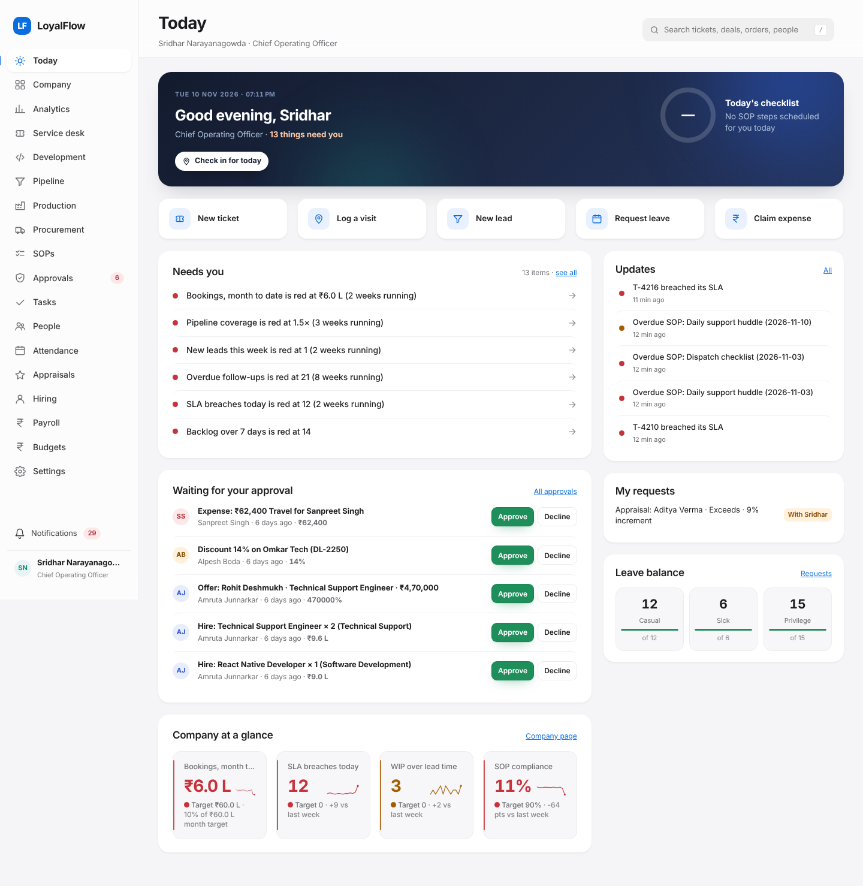 | 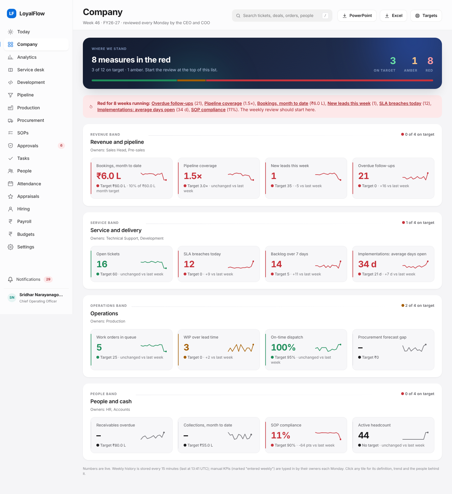 |
| 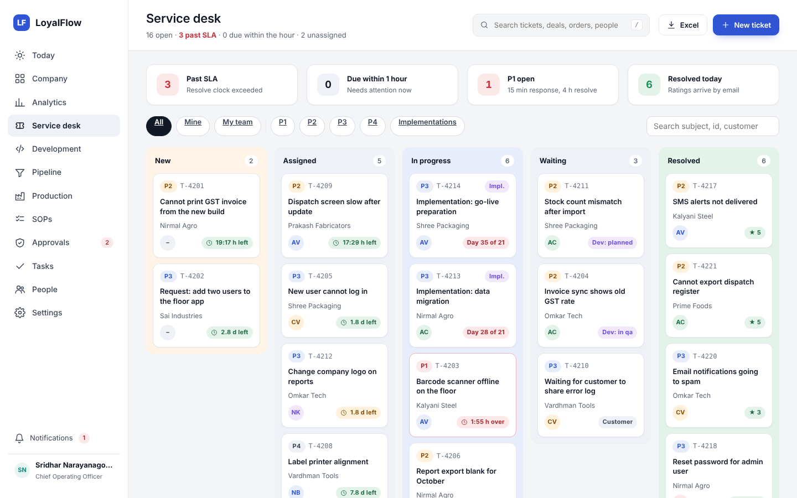 | 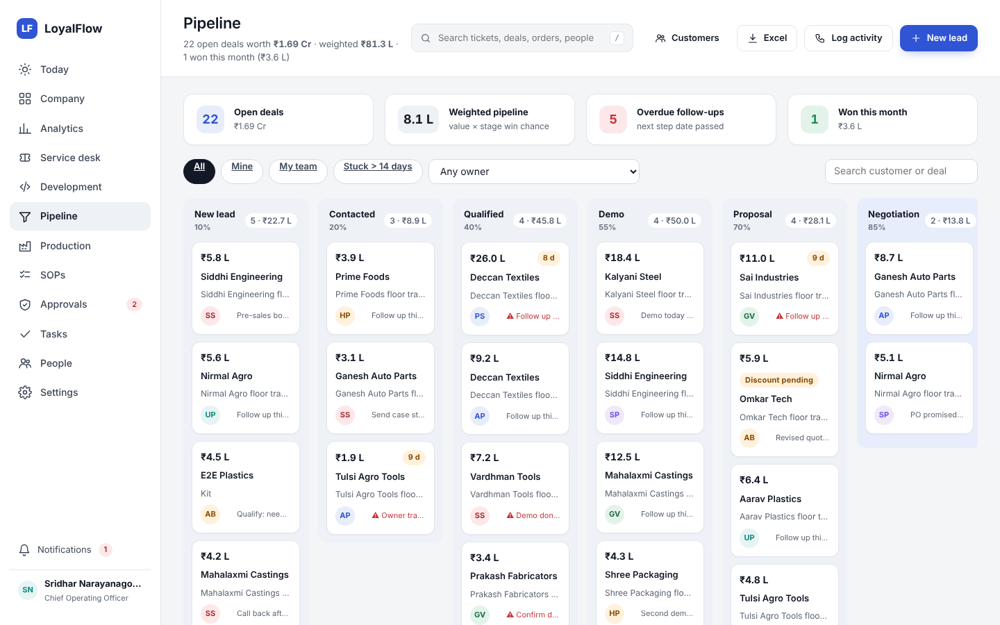 |
| 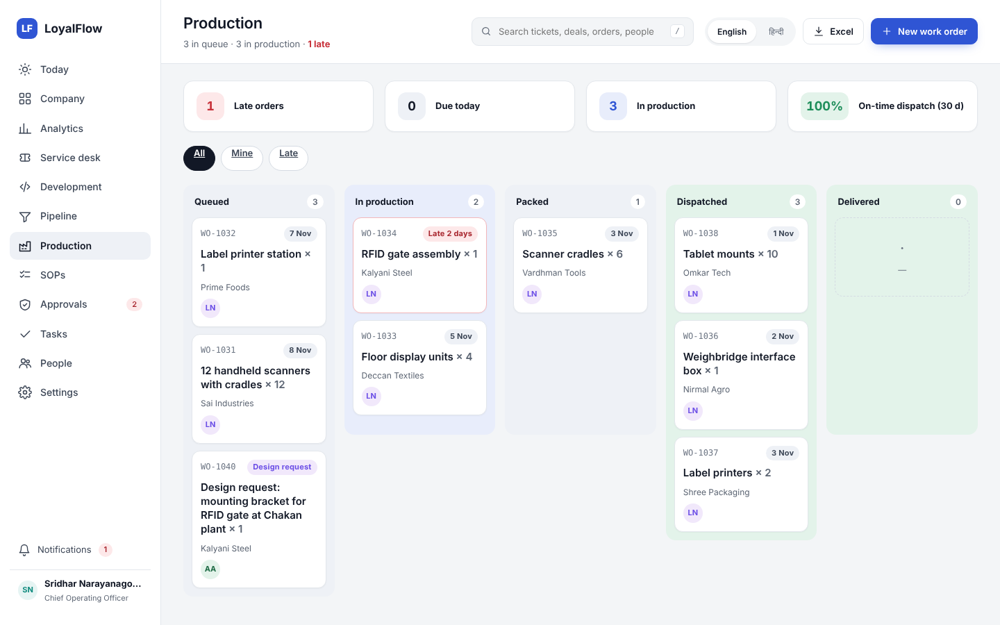 | 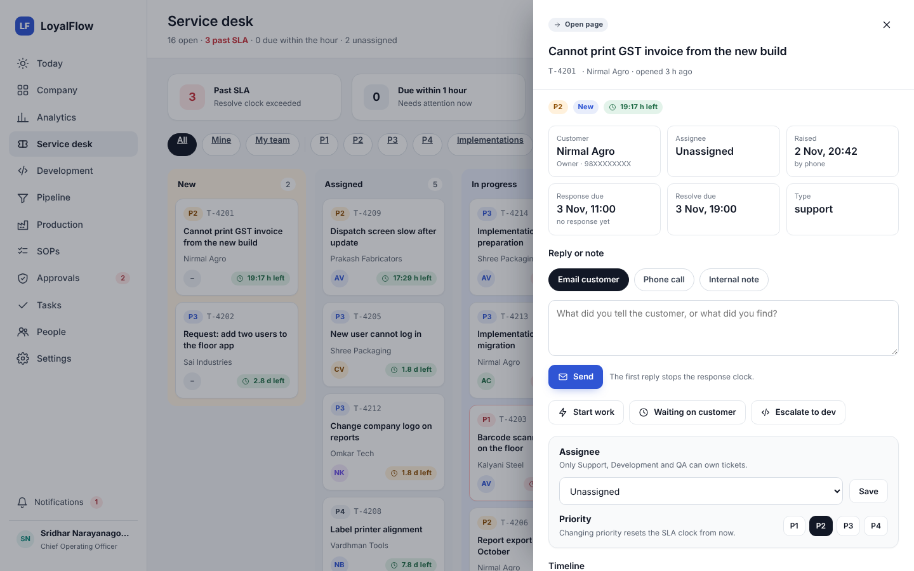 |
| 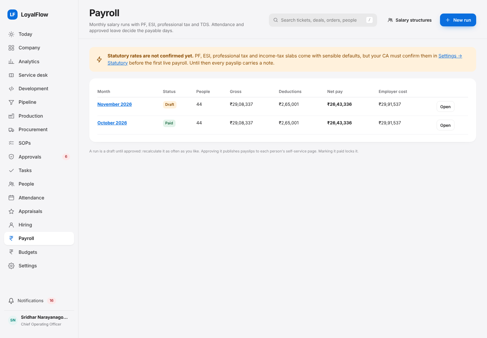 | 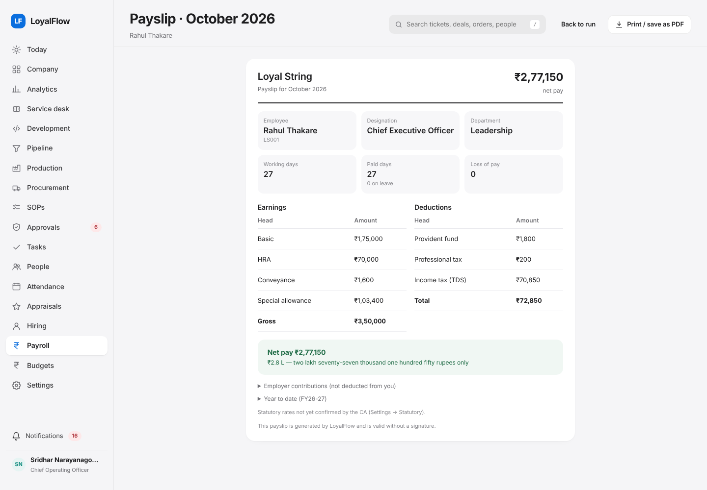 |
| 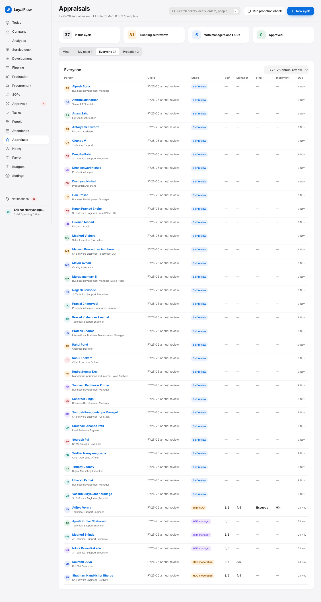 | 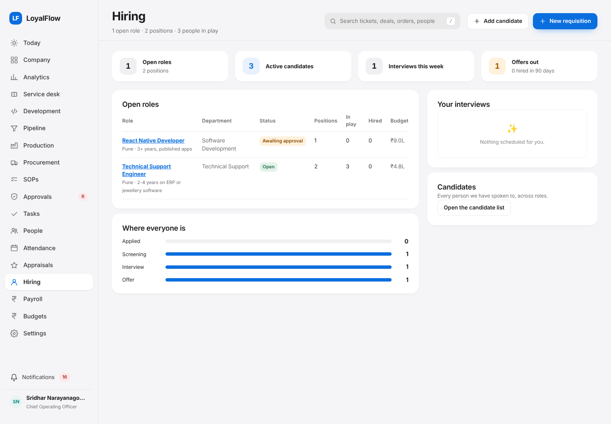 |
| 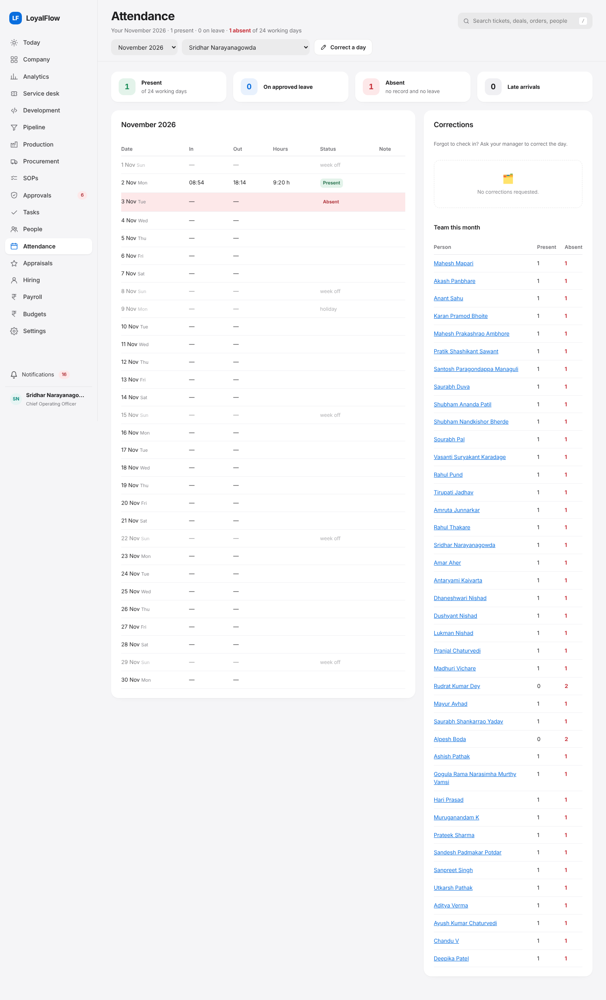 | 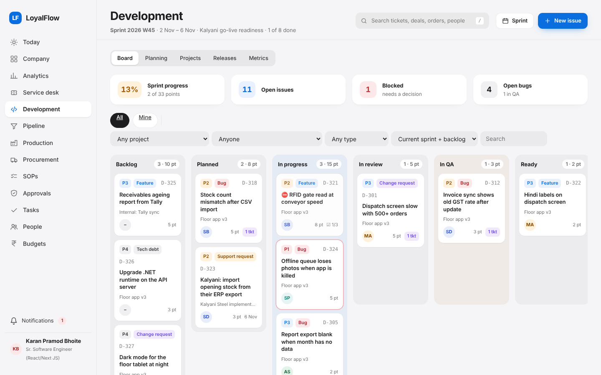 |

## Hosting
- GitHub and Hostinger VPS, step by step: [docs/DEPLOY-HOSTINGER.md](docs/DEPLOY-HOSTINGER.md)
- General deployment notes: [docs/DEPLOY.md](docs/DEPLOY.md)
